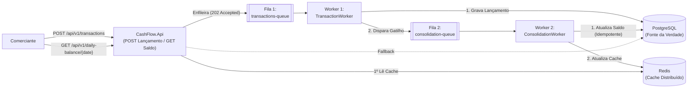

# CashFlow — Controle de Lançamentos & Consolidado Diário (.NET 8)

Solução completa desenvolvida em **C# (.NET 8)** para o desafio técnico de **Arquiteto de Software**, contemplando controle de lançamentos financeiros (créditos e débitos) e relatório de saldo diário consolidado com foco em **resiliência, desacoplamento, escalabilidade, segurança e simplicidade operacional**.

---

## Sumário

1. [Visão Arquitetural e Destaques](#1-visão-arquitetural-e-destaques)
2. [Documentação Arquitetural e ADRs](#2-documentação-arquitetural-e-adrs)
3. [Estrutura da Solution](#3-estrutura-da-solution)
4. [Como Executar Localmente (Docker Compose)](#4-como-executar-localmente-docker-compose)
5. [Como Testar a Aplicação (Passo a Passo)](#5-como-testar-a-aplicação-passo-a-passo)
6. [Como Executar os Testes Automatizados](#6-como-executar-os-testes-automatizados)

---

## 1. Visão Arquitetural e Destaques

A arquitetura foi desenhada para responder diretamente às premissas críticas do negócio:

- **Ingestão Não-Bloqueante (`202 Accepted`):** O endpoint `POST /api/v1/transactions` realiza apenas a validação do payload e publica o comando na **Fila 1 (`transactions-queue`)** do RabbitMQ, liberando a requisição imediatamente sem bloquear em locks de banco de dados.
- **Isolamento por Workers Independentes (*Bulkhead Pattern*):**
  - **`CashFlow.TransactionWorker` (Worker 1):** Consome a Fila 1, persiste o lançamento no **PostgreSQL** de forma idempotente e dispara um gatilho na **Fila 2 (`consolidation-queue`)**.
  - **`CashFlow.ConsolidationWorker` (Worker 2):** Consome a Fila 2, atualiza de forma atômica e idempotente o saldo diário na tabela `daily_balances` (**PostgreSQL — Fonte da Verdade**) e atualiza o cache distribuído no **Redis**.
  - **Resiliência à Queda do Consolidado:** Se o `ConsolidationWorker` cair, a `CashFlow.Api` e o `TransactionWorker` continuam recebendo e gravando 100% dos lançamentos normalmente. Quando o `ConsolidationWorker` retorna, ele processa a fila acumulada sem perder 1 centavo.
- **Consulta Instantânea ($O(1)$) com Cache Distribuído (Redis) e Fallback:** O saldo nunca é calculado durante o `GET`. O endpoint `GET /api/v1/daily-balance/{date}` entrega o dado **já computado** a partir do **Redis** (com *fallback* transparente para o **PostgreSQL** caso o Redis esteja indisponível), atendendo com ampla folga ao pico de **50 requisições por segundo com 0% de perda**.
- **Sem Over-Engineering (Sem API Gateway):** Dimensionamento fundamentado na capacidade real do Kestrel (.NET 8) e na Lei de Little (detalhado no [ADR-002](docs/adr/0002-no-api-gateway-decision.md)).



---

## 2. Documentação Arquitetural e ADRs

Toda a documentação de arquitetura do projeto está disponível no repositório:

- **[Documentação Completa de Arquitetura, Fluxos, Métricas (SLIs/SLOs) e Evoluções Futuras](docs/architecture.md)**
- **Architecture Decision Records (ADRs):**
  - [ADR-001: Arquitetura Orientada a Eventos com Filas e Workers Isolados (SEDA / Bulkhead)](docs/adr/0001-event-driven-workers-isolation.md)
  - [ADR-002: Decisão de Não Utilizar um API Gateway na Aplicação](docs/adr/0002-no-api-gateway-decision.md)
  - [ADR-003: Consistência Eventual, Idempotência e Garantia de Entrega](docs/adr/0003-eventual-consistency-and-idempotency.md)
  - [ADR-004: Estratégia de Cache Distribuído (Redis) vs. Cache em Memória e Fonte da Verdade no PostgreSQL](docs/adr/0004-redis-distributed-cache-and-source-of-truth.md)
  - [ADR-005: Segurança — Autenticação JWT, Autorização, Criptografia e Rate Limiting](docs/adr/0005-security-jwt-and-rate-limiting.md)

---

## 3. Estrutura da Solution

```text
processo-verity/
├── docs/
│   ├── architecture.md                        # Desenho da solução, fluxos, NFRs e evoluções futuras
│   └── adr/                                   # Architecture Decision Records (ADR-001 a ADR-005)
├── src/
│   ├── CashFlow.Domain/                       # Entidades (Transaction, DailyBalance, ProcessedTransaction), Result Pattern, Interfaces
│   ├── CashFlow.Application/                  # Casos de Uso, FluentValidation, DTOs, Contratos de Filas e Cache
│   ├── CashFlow.Infrastructure/               # EF Core (PostgreSQL), MassTransit (RabbitMQ), Redis Cache, JWT Security
│   ├── CashFlow.Api/                          # Web API (.NET 8 Minimal APIs, Auth JWT, Rate Limiting, OpenTelemetry, HealthChecks, Swagger)
│   ├── CashFlow.TransactionWorker/            # Worker 1: Consome Fila 1 -> Grava Lançamento -> Publica na Fila 2
│   └── CashFlow.ConsolidationWorker/          # Worker 2: Consome Fila 2 -> Consolida Saldo no Banco -> Atualiza Redis
├── tests/
│   ├── CashFlow.UnitTests/                    # Testes de Unidade (Domínio, Validações, Idempotência dos Workers, Fallback do Cache)
│   ├── CashFlow.IntegrationTests/             # Testes de Integração Ponta a Ponta, Resiliência à Queda e Pico de 50+ RPS
│   └── CashFlow.LoadTests/                    # Suite de Stress, Concorrência (100 escritas), Carga (>50 RPS) e Chaos Test no Docker
├── docker-compose.yml                         # Orquestração completa dos 6 containers
└── CashFlow.sln
```

---

## 4. Como Executar Localmente (Docker Compose)

### Pré-requisitos
- [Docker](https://www.docker.com/) e Docker Compose instalados.
- *(Opcional para rodar fora do Docker)* [.NET 8 SDK](https://dotnet.microsoft.com/download/dotnet/8.0).

### Subindo todo o ambiente com 1 comando

Na raiz do repositório, execute:

```bash
docker compose up -d --build
```

O Docker Compose subirá automaticamente os **6 serviços** com *healthchecks* e criação automática das tabelas no PostgreSQL:
- **Swagger UI (`CashFlow.Api`):** `http://localhost:5000/swagger`
- **Health Checks:** `http://localhost:5000/health/live` e `http://localhost:5000/health/ready`
- **RabbitMQ Management UI:** `http://localhost:15672` (usuário: `guest` / senha: `guest`)
- **PostgreSQL:** `localhost:5432` (`cashflow_db`)
- **Redis:** `localhost:6379`

---

## 5. Como Testar a Aplicação (Passo a Passo)

Você pode testar diretamente pelo **Swagger UI** em `http://localhost:5000/swagger` ou via terminal (`curl`):

### Passo 1: Gerar o Token JWT (`POST /api/v1/auth/token`)

```bash
curl -X POST http://localhost:5000/api/v1/auth/token \
  -H "Content-Type: application/json" \
  -d "{\"username\": \"comerciante\", \"password\": \"Verity@2026\"}"
```

Copie o `accessToken` retornado (no Swagger, clique no botão **Authorize** e informe o token).

### Passo 2: Registrar Lançamentos (`POST /api/v1/transactions`)

**Exemplo de Crédito (R$ 1.500,00):**
```bash
curl -X POST http://localhost:5000/api/v1/transactions \
  -H "Authorization: Bearer SEU_TOKEN_AQUI" \
  -H "Content-Type: application/json" \
  -d "{\"amount\": 1500.00, \"type\": \"Credit\", \"date\": \"2026-11-16\", \"description\": \"Venda de mercadorias\"}"
```

**Exemplo de Débito (R$ 350,50):**
```bash
curl -X POST http://localhost:5000/api/v1/transactions \
  -H "Authorization: Bearer SEU_TOKEN_AQUI" \
  -H "Content-Type: application/json" \
  -d "{\"amount\": 350.50, \"type\": \"Debit\", \"date\": \"2026-11-16\", \"description\": \"Pagamento de fornecedor\"}"
```

> Ambos retornam `202 Accepted` imediatamente com o `transactionId`.

### Passo 3: Consultar o Saldo Diário Consolidado (`GET /api/v1/daily-balance`)

A data é **opcional**: se não for informada, a API assume automaticamente a **data atual**.

**Consultando o saldo da data atual (sem informar parâmetro):**
```bash
curl -X GET "http://localhost:5000/api/v1/daily-balance" \
  -H "Authorization: Bearer SEU_TOKEN_AQUI"
```

**Consultando uma data específica (`?date=YYYY-MM-DD`):**
```bash
curl -X GET "http://localhost:5000/api/v1/daily-balance?date=2026-11-16" \
  -H "Authorization: Bearer SEU_TOKEN_AQUI"
```

**Resposta esperada (`200 OK`):**
```json
{
  "date": "2026-11-16",
  "totalCredits": 1500.00,
  "totalDebits": 350.50,
  "netBalance": 1149.50,
  "transactionCount": 2,
  "lastUpdatedAtUtc": "2026-11-16T21:15:00Z",
  "source": "RedisCache"
}
```

### Passo 4: Simular a Queda do Serviço de Consolidado Diário

Para comprovar na prática o requisito não-funcional obrigatório (*"O serviço de controle de lançamento não deve ficar indisponível se o sistema de consolidado diário cair"*):

1. Pare o container do Worker de Consolidação:
   ```bash
   docker stop cashflow-consolidation-worker
   ```
2. Continue enviando novos lançamentos normalmente no `POST /api/v1/transactions` — a API continuará respondendo `202 Accepted` e o `cashflow-transaction-worker` continuará gravando todos os lançamentos no PostgreSQL.
3. Suba novamente o Worker de Consolidação:
   ```bash
   docker start cashflow-consolidation-worker
   ```
4. Consulte o `GET /api/v1/daily-balance/2026-11-16` e veja que todos os lançamentos enviados durante a queda foram consolidados automaticamente sem nenhuma perda!

---

## 6. Como Executar os Testes Automatizados

### 6.1. Testes de Unidade e Integração (`xUnit`)

A solução conta com **21 testes automatizados** (16 de Unidade + 5 de Integração) utilizando **xUnit**, **FluentAssertions**, **NSubstitute** e **WebApplicationFactory**, cobrindo:
- Regras de domínio de Lançamentos (`Transaction`) e Saldo Diário (`DailyBalance`).
- Validações de contrato (`FluentValidation`).
- Garantia de **Idempotência** do `TransactionWorker` e do `ConsolidationWorker` (mensagens repetidas não duplicam lançamentos nem somam saldo duas vezes).
- Degradação graciosa (*fallback* automático para o banco de dados quando o Redis falha).
- Fluxo ponta a ponta da API autenticada com JWT, parâmetro opcional de data (assumindo a data atual), teste de queda do consolidado diário e teste de carga concorrente (>50 req/s com 0% de perda).

Para executar todos os testes de unidade e integração (não requer Docker ligado, pois os testes de integração utilizam infraestrutura em memória isolada):

```bash
dotnet test --verbosity normal
```

---

### 6.2. Suite de Concorrência, Carga (> 50 RPS) e Chaos Test no Ambiente Real (`CashFlow.LoadTests`)

Para validar os requisitos não-funcionais do PDF diretamente contra o ambiente real em containers (**Docker + PostgreSQL + RabbitMQ + Redis**), o projeto inclui o runner executável `tests/CashFlow.LoadTests`.

Com os containers rodando (`docker compose up -d`), basta executar:

```bash
dotnet run --project tests/CashFlow.LoadTests
```

O runner executa automaticamente **3 baterias de validação real** e imprime o relatório no terminal:
1. **Cenário 1 — Concorrência Pesada e Exatidão Contábil:** Dispara **100 lançamentos simultâneos** (60 créditos de R\$ 100,00 e 40 débitos de R\$ 50,00), aguarda a convergência das filas e valida matematicamente se o saldo consolidado crava `R$ 4.000,00` (`100` lançamentos) sem *Lost Updates*.
2. **Cenário 2 — Pico de Requisições no Consolidado Diário (>= 50 RPS com <= 5% de perda):** Sustenta **~75 req/s** no endpoint `GET /api/v1/daily-balance`, aferindo vazão real (RPS), taxa de perda (`0,00%`) e latências `Média`, `P50`, `P95` e `P99`.
3. **Cenário 3 — Resiliência à Queda do Consolidado (`Chaos Test`):** Derruba o container `cashflow-consolidation-worker` (`docker stop`), dispara 20 lançamentos comprovando **100% de disponibilidade** na API (`202 Accepted`), religa o container (`docker start`) e comprova que a fila represada é processada sem perda de nenhum lançamento.
