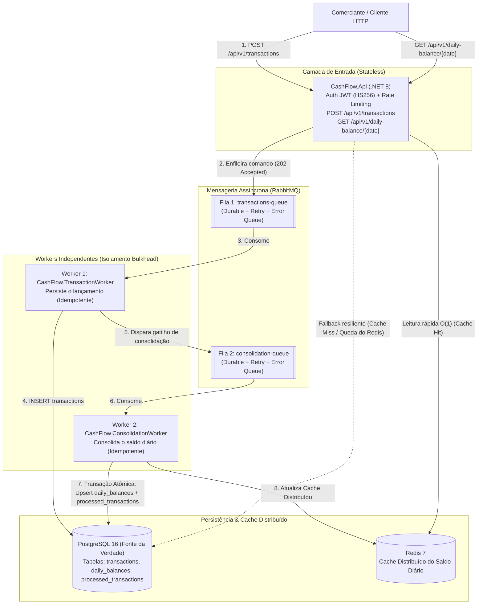
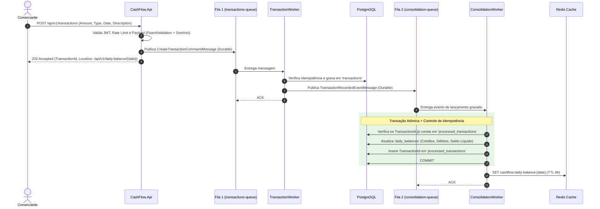
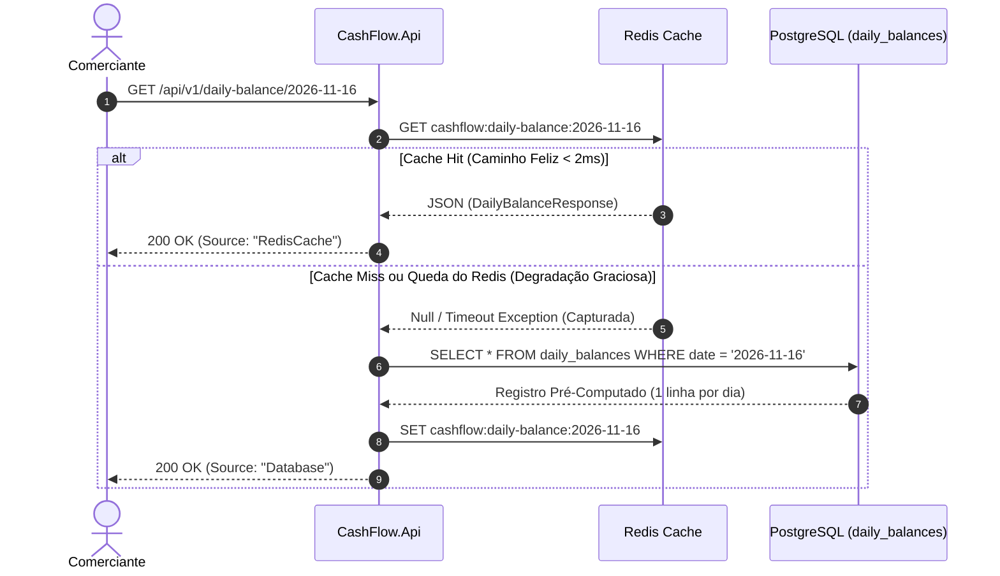

# Documentação de Arquitetura — Sistema de Fluxo de Caixa Diário

Este documento detalha o desenho da solução, os fluxos de dados, o atendimento aos requisitos não-funcionais (com métricas operacionais SLIs/SLOs) e o plano de evoluções futuras do sistema.

---

## 1. Visão Geral do Desenho da Solução

A arquitetura foi projetada com base em três pilares fundamentais extraídos do desafio:
1. **Isolamento Total de Processamento:** O controle de lançamentos jamais deve ficar indisponível se o processamento do consolidado diário cair.
2. **Zero Perda de Lançamentos:** Um lançamento perdido impacta diretamente o saldo financeiro do comerciante. Por isso, o endpoint de lançamento executa o mínimo de processamento síncrono (validação de payload) e enfileira imediatamente a operação em uma fila durável (`transactions-queue`).
3. **Consolidação Orientada a Gatilho (Dado Pré-Computado):** O consolidado diário não é calculado durante a requisição `GET`. Cada lançamento gravado pelo `TransactionWorker` dispara um evento na fila `consolidation-queue`, consumido pelo `ConsolidationWorker`, que atualiza o saldo pré-computado no **PostgreSQL** (Fonte da Verdade) e sincroniza o cache distribuído no **Redis**.

### Diagrama de Arquitetura e Componentes

---

## 2. Fluxos Detalhados de Dados

### 2.1. Fluxo de Escrita e Consolidação Assíncrona

### 2.2. Fluxo de Leitura do Consolidado Diário (Alta Performance: 50+ RPS)

---

## 3. Atendimento aos Requisitos Não-Funcionais e Métricas (SLIs / SLOs)

| Pilar Arquitetural | Solução Aplicada | Métrica Operacional (SLI / SLO) |
| :--- | :--- | :--- |
| **Escalabilidade** | `CashFlow.Api`, `TransactionWorker` e `ConsolidationWorker` são 100% *stateless*, permitindo dimensionamento horizontal. O uso do **Redis** evita divergência de memória entre réplicas da API. | Suporte a **> 50 req/s** (capacidade real testada na casa de centenas de req/s) com **0% de perda de requisições** (limite do desafio: máx 5%). |
| **Resiliência & Disponibilidade** | Desacoplamento via 2 filas duráveis no RabbitMQ, *Retry* com *Exponential Backoff*, *Dead-Letter Queues* e *fallback* automático do Redis para o PostgreSQL. | **100% de disponibilidade** na recepção de lançamentos mesmo com o `ConsolidationWorker` totalmente desligado. |
| **Integridade & Confiabilidade** | Controle de idempotência ponta a ponta (`TransactionId` único desde a entrada + tabela `processed_transactions` em transação atômica com `daily_balances` + *Optimistic Concurrency* com `xmin`). | **0% de perda de lançamentos** e **0% de duplicidade** no cálculo do saldo diário em cenários de reentrega de mensagens. |
| **Segurança** | Autenticação JWT Bearer assinada com `HMAC-SHA256`, Autorização baseada em *Roles* (`Merchant`) e *Scopes* (`cashflow.write`, `cashflow.read`), *Rate Limiting* contra DoS/Brute Force e validação estrita de entrada. | Rejeição imediata (`401`/`403`/`429`/`400`) de requisições não autorizadas, abusivas ou malformadas. |
| **Observabilidade** | Instrumentação nativa com **OpenTelemetry** (Traces e Métricas HTTP), logs estruturados com correlação por `TransactionId` e endpoints de **Health Check** (`/health/live` e `/health/ready`). | Latência P95 de ingestão e leitura **< 15ms**; janela de consistência eventual em operação normal **< 50ms**. |

---

## 4. Índice de Decisões Arquiteturais (ADRs)

Todas as decisões e *trade-offs* estão documentados individualmente em `docs/adr/`:
- [ADR-001: Arquitetura Orientada a Eventos com Filas e Workers Isolados (SEDA / Bulkhead)](adr/0001-event-driven-workers-isolation.md)
- [ADR-002: Decisão de Não Utilizar um API Gateway na Aplicação](adr/0002-no-api-gateway-decision.md)
- [ADR-003: Consistência Eventual, Idempotência e Garantia de Entrega](adr/0003-eventual-consistency-and-idempotency.md)
- [ADR-004: Estratégia de Cache Distribuído (Redis) vs. Cache em Memória e Fonte da Verdade no PostgreSQL](adr/0004-redis-distributed-cache-and-source-of-truth.md)
- [ADR-005: Segurança — Autenticação JWT, Autorização, Criptografia e Rate Limiting](adr/0005-security-jwt-and-rate-limiting.md)

---

## 5. Evoluções Futuras para Produção

Conforme incentivado pelo desafio (*"descrições sobre o que você gostaria de ter implementado ou evoluções futuras"*), os próximos passos naturais para evolução produtiva do sistema são:

1. **Outbox Pattern / Fallback Local na Borda da Web API:**
   - Caso o cluster RabbitMQ inteiro fique indisponível no exato momento do `POST`, a Web API pode contar com um buffer resiliente local ou persistência de contingência para garantir disponibilidade mesmo sob falha catastrófica da mensageria.
2. **Job de Reconciliação Contábil Noturna (Auditoria Automatizada):**
   - Um *Job* agendado (ex.: Hangfire / Quartz / CronJob K8s) executado na madrugada para comparar `SUM(creditos) - SUM(debitos)` da tabela `transactions` contra o `net_balance` da tabela `daily_balances` do dia anterior, emitindo alertas caso haja qualquer discrepância.
3. **Auto-Scaling Baseado em Filas com KEDA (Kubernetes Event-Driven Autoscaling):**
   - Escalonar automaticamente o número de réplicas do `TransactionWorker` e do `ConsolidationWorker` no Kubernetes com base no tamanho das filas `transactions-queue` e `consolidation-queue` no RabbitMQ.
4. **Suporte Multi-Tenant (`MerchantId`) e Fechamento Contábil Imutável:**
   - Inclusão da coluna `merchant_id` extraída diretamente das *claims* do token JWT para suportar múltiplos comerciantes na mesma plataforma, além de bloqueio de lançamentos retroativos diretos em caixas já fechados (exigindo lançamento de ajuste/estorno).
5. **Stack Visual de Observabilidade (Grafana + Prometheus + Jaeger/Tempo):**
   - Exportação OTLP do OpenTelemetry (já configurado na API) para dashboards executivos de vazão de lançamentos, tempo médio de consolidação e monitoramento de *Dead-Letter Queues*.
